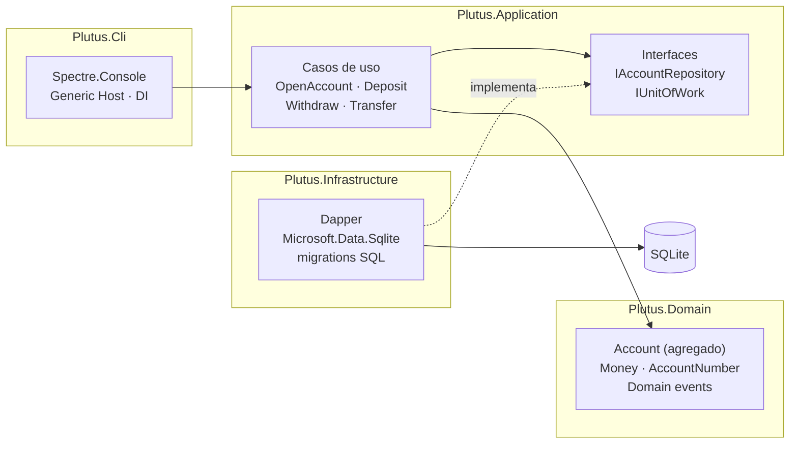
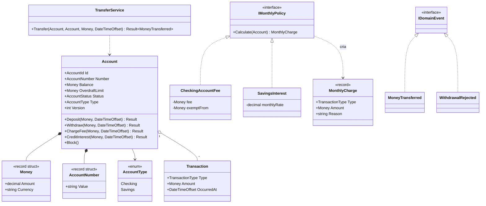
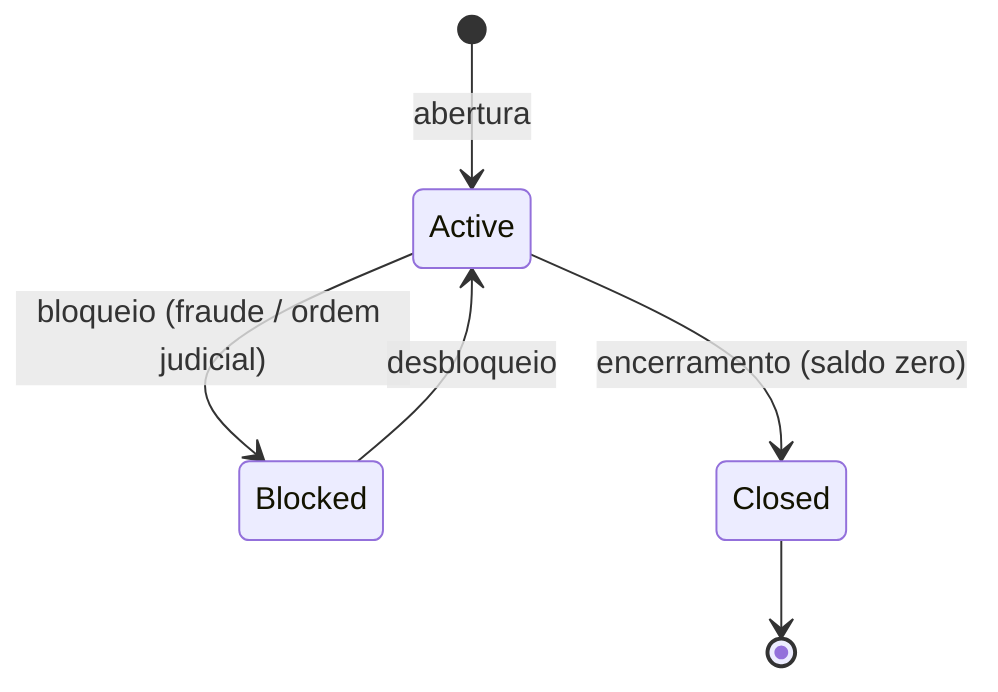
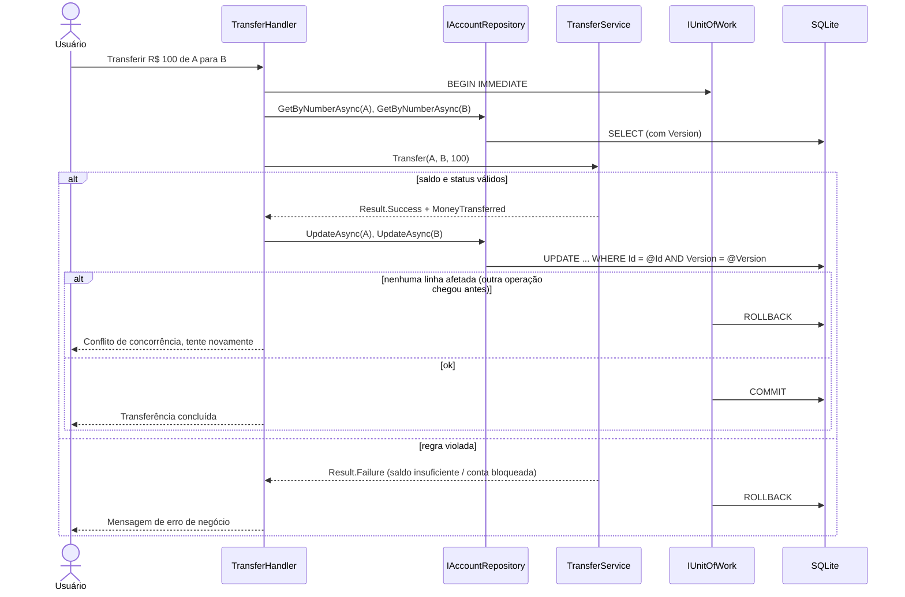

<div align="center">


# ⚖ Plutus
### O deus da riqueza guarda cada centavo

**Livro-razão bancário em C# / .NET 10, com foco em modelagem de domínio.**
Contas correntes e poupanças, depósitos, saques, transferências, extratos, tarifas e rendimentos,<br/>com regras protegidas pelo próprio domínio,
transações explícitas com Dapper e concorrência otimista testada sob carga paralela.

[](https://github.com/GustavoThe01/plutus-ledger/actions/workflows/ci.yml)


</div>

---

## 👨‍💻 Autor

<table>
  <tr>
    <td width="62%">

Eu sou o **Gustavo Osterno Thé**, e o **Plutus** é um dos cinco projetos do meu portfólio público de Desenvolvedor Pleno. Idealizei, desenvolvo e mantenho este repositório.

Um sistema financeiro é o lugar onde **erros custam dinheiro de verdade**. Por isso pensei o Plutus para mostrar como um domínio bem modelado impede estados inválidos, como transações garantem consistência e como testar o que acontece quando duas operações tentam mexer no mesmo saldo ao mesmo tempo.

    </td>
    <td width="38%">

| | |
|---|---|
| 🌐 Site | [site-gustavothe-dev.web.app](https://site-gustavothe-dev.web.app/) |
| 💼 LinkedIn | [gustavoosterno](https://www.linkedin.com/in/gustavoosterno/) |
| 🐙 GitHub | [@GustavoThe01](https://github.com/GustavoThe01) |
| 📸 Instagram | [@gustavo.osterno](https://www.instagram.com/gustavo.osterno) |

    </td>
  </tr>
</table>

---

## 📑 Sumário

- [Em números](#-em-números)
- [A origem do nome](#-a-origem-do-nome)
- [O que o sistema faz](#-o-que-o-sistema-faz)
- [Arquitetura](#️-arquitetura)
- [Modelo de domínio](#-modelo-de-domínio)
- [Como uma transferência acontece](#-como-uma-transferência-acontece)
- [Extrato com LINQ](#-extrato-com-linq)
- [Tarifas e rendimentos com Strategy](#-tarifas-e-rendimentos-com-strategy)
- [Competências demonstradas](#-competências-demonstradas)
- [Metodologias e decisões](#-metodologias-e-decisões)
- [Roadmap](#️-roadmap)
- [Como rodar](#-como-rodar)
- [Testes](#-testes)
- [Estrutura do projeto](#-estrutura-do-projeto)
- [O que ainda falta](#-o-que-ainda-falta)
- [Projetos relacionados](#-projetos-relacionados)

---

## 📊 Em números

<div align="center">

| 💎 Domínio | 🧱 Arquitetura | 🧪 Qualidade | 🗓️ Processo |
|:---:|:---:|:---:|:---:|
| **1** agregado (`Account`) | **4** projetos + **5** de teste | **147** testes · warnings como **erro** | **10** dias de roadmap |
| value objects com `record struct` | regra de dependência **testada** | xUnit v3 · Microsoft.Testing.Platform | **2** ADRs registrados |
| domain events + Result pattern + Strategy | Central Package Management | NetArchTest · **93,6%** de cobertura | Conventional Commits |

<sub>Números medidos na versão 1.0.0. Os detalhes estão na seção <a href="#-testes">Testes</a>.</sub>

</div>

---

## ⚖ A origem do nome

> *Plutus, filho de Deméter, era o deus grego da riqueza. Segundo o mito, Zeus o cegou para que ele não distinguisse justos de injustos ao distribuir a fortuna.*

Escolhi o nome porque um livro-razão precisa ter essa mesma cegueira: ser **imparcial e exato**. No Plutus, cada centavo que entra ou sai é registrado, nenhum saldo muda sem uma transação que o justifique, e as regras valem igualmente para todas as contas.

---

## ✨ O que o sistema faz

| Módulo | O que resolve |
|---|---|
| 🏦 **Contas** | Conta corrente ou poupança; abertura, bloqueio e encerramento, com número de conta validado |
| ➕ **Depósitos** | Entrada de valores com registro no extrato |
| ➖ **Saques** | Respeitam saldo e limite; conta bloqueada não movimenta |
| 🔁 **Transferências** | Débito e crédito na **mesma transação**: ou acontecem os dois, ou nenhum |
| 📜 **Extrato** | Por período, paginado, com saldo acumulado e resumo mensal (LINQ) |
| 💸 **Tarifas e juros** | Fechamento do mês: tarifa na conta corrente, rendimento na poupança (Strategy), sem cobrar duas vezes |
| 🖥️ **Console** | Interface rica com Spectre.Console: tabelas, cores e prompts |

---

## 🏛️ Arquitetura



| Projeto | Responsabilidade | Depende de |
|---|---|---|
| `Plutus.Domain` | Regras de negócio puras | — |
| `Plutus.Application` | Orquestra casos de uso | Domain |
| `Plutus.Infrastructure` | Banco, Dapper, migrations | Application |
| `Plutus.Cli` | Interface e composition root | Application, Infrastructure |

> ✅ A regra "**Domain não depende de ninguém**" já está protegida por um teste automatizado que escrevi no Dia 01 ([`LayerDependencyTests`](tests/Plutus.Domain.Tests/LayerDependencyTests.cs)).

---

## 🧬 Modelo de domínio



### Estados de uma conta



---

## 🔁 Como uma transferência acontece



**Concorrência na prática.** No SQLite, o `BEGIN IMMEDIATE` já faz as escritas acontecerem uma de cada vez;
a coluna `Version` é a garantia que não depende do banco ([ADR 0002](docs/adr/0002-concorrencia.md)). Os testes provam as duas:

- **300 transferências em paralelo** entre três contas com R$ 1.000 cada. Nas rodadas que fiz, de 284 a 299
  passaram, e as outras foram recusadas por saldo insuficiente. Em todas, o total continuou R$ 3.000,00, e o saldo
  de cada conta bateu com a soma dos seus lançamentos. Cada rodada levou cerca de 4 s.
- **Lost update barrado:** uma operação lê a conta, outra deposita R$ 50 e confirma, e a primeira tenta gravar.
  O `UPDATE` não acha a versão lida e a gravação é recusada; o depósito de R$ 50 continua lá.

---

## 📜 Extrato com LINQ

O extrato sai em duas formas: **paginado**, com cada lançamento e o saldo depois dele, e **resumido por mês**,
com entradas, saídas e saldo de fechamento. As duas consultas estão em
[`Statement.cs`](src/Plutus.Application/Accounts/Statement.cs) e usam LINQ sobre os lançamentos do período.

```csharp
transactions
    .OrderBy(t => t.OccurredAt)
    .GroupBy(t => t.OccurredAt.ToUniversalTime().ToString("yyyy-MM", CultureInfo.InvariantCulture))
    .Select(month => new MonthlySummary(month.Key, inflows, outflows, inflows - outflows,
                                        month.Last().BalanceAfter.Amount, month.Count()))
    .ToList();
```

**`IEnumerable` ou `IQueryable`?** Aqui o LINQ roda em memória, sobre `IEnumerable<T>`. O Dapper já trouxe
os lançamentos do período com um `WHERE` por data, e o agrupamento acontece no C#. Com `IQueryable<T>` e um ORM
como o EF Core, o mesmo LINQ seria traduzido para SQL e rodaria no banco, mas só com operações que o provedor sabe
traduzir. Escolhi `IEnumerable` porque o Plutus não usa ORM e o período do extrato já é limitado
(`MaxStatementDays`). O Bifrost, meu outro projeto em .NET, mostra o lado do `IQueryable` com EF Core.

**Execução adiada.** Um `Where` ou `Select` não roda na hora: ele descreve a consulta, que só executa quando alguém
percorre o resultado. Se a sequência for percorrida duas vezes, a consulta roda duas vezes. Por isso a paginação
materializa a fonte uma única vez (`ToList`) antes de contar o total e cortar a página, e existe um teste que
garante isso.

---

## 💸 Tarifas e rendimentos com Strategy

No fim de cada mês, a conta corrente paga uma tarifa e a poupança rende juros. São duas regras diferentes para a
mesma pergunta ("o que lançar nesta conta no fechamento?"), então cada uma virou uma classe que implementa
[`IMonthlyPolicy`](src/Plutus.Domain/Accounts/MonthlyPolicies.cs):

| Tipo de conta | Regra | Valores padrão (`appsettings.json`) |
|---|---|---|
| Conta corrente | Tarifa mensal, **isenta** se o saldo no fechamento for de pelo menos R$ 5.000 | `CheckingMonthlyFee` 12,90 · `CheckingFeeExemptBalance` 5000 |
| Poupança | Rendimento sobre o saldo, **truncado** no centavo; poupança não tem cheque especial | `SavingsMonthlyRate` 0,005 (0,5% ao mês) |

```csharp
public interface IMonthlyPolicy
{
    MonthlyCharge? Calculate(Account account); // null quando não há nada a lançar
}
```

O caso de uso [`CloseMonth`](src/Plutus.Application/Accounts/CloseMonth.cs) não tem nenhum `if` por tipo de conta:
pede a regra ao `MonthlyPolicyCatalog` e aplica o lançamento. Um tipo novo de conta seria uma classe nova, sem mexer
nas que já existem.

Decisões que tomei no fechamento:

- **Idempotente.** Cada conta fechada ganha uma linha em `monthly_closing` (chave: conta + mês), gravada na mesma
  transação do lançamento. Fechar o mesmo mês de novo não cobra nem paga duas vezes; o teste de integração roda
  o fechamento duas vezes e confere o saldo.
- **Só meses encerrados.** Fechar o mês corrente ou um mês futuro é recusado.
- **Tarifa sem saldo não vira dívida escondida.** Se a tarifa não cabe no saldo nem no limite, nada é gravado e o
  mês continua aberto para aquela conta; depois de um depósito, fechar de novo cobra a tarifa.
- **Uma transação por conta.** Um conflito de concorrência numa conta não desfaz o fechamento das outras.
- **Truncar, não arredondar.** R$ 199,99 a 0,5% dá R$ 0,99995: o rendimento é R$ 0,99, nunca R$ 1,00. Assim a soma
  dos rendimentos nunca passa da taxa contratada.

A migration [`V003`](src/Plutus.Infrastructure/Migrations/V003__account_type_and_monthly_closing.sql) acrescenta o
tipo de conta (as contas antigas viram conta corrente) e recria a tabela de lançamentos com os tipos `Fee` e
`Interest` no `CHECK`, porque o SQLite não altera um `CHECK` existente. Um teste monta um banco como ele estava no
Dia 09, com dados, aplica a V003 e confere que saldo, limite e a ordem dos lançamentos continuam iguais.

---

## 🧠 Competências demonstradas

| Área | Conceitos |
|---|---|
| **DDD tático** | Agregados, entidades, value objects, domain services, domain events, linguagem ubíqua |
| **C# moderno** | `record`/`record struct`, nullable reference types, `required`, pattern matching |
| **Tratamento de erros** | **Result pattern** para regras de negócio, exceções só para o inesperado |
| **Dados** | Dapper, SQL escrito à mão, `IDbTransaction`, migrations SQL versionadas |
| **Concorrência** | Concorrência **otimista** com coluna `Version`, teste de transferências paralelas |
| **Assíncrono** | `async/await` com `CancellationToken` ponta a ponta |
| **LINQ** | Projeções, agrupamentos, execução adiada, `IEnumerable` vs `IQueryable` |
| **Polimorfismo** | **Strategy** para as regras de fim de mês, sem `if` por tipo de conta no caso de uso |
| **Distribuição** | `dotnet publish` single-file e self-contained para Windows e Linux |
| **Infra .NET** | Generic Host, DI, Options pattern, `ILogger` |
| **Organização** | `.slnx`, `Directory.Build.props`, Central Package Management, `.editorconfig` |
| **Testes** | xUnit v3, NSubstitute, testes de integração e de arquitetura |

---

## 🧭 Metodologias e decisões

- **TDD** no domínio: primeiro escrevo o teste que descreve a regra, depois a implementação.
- **Roadmap diário público** — avanço um dia de cada vez e registro tudo no [ROADMAP.md](ROADMAP.md).
- **Conventional Commits**, versionamento semântico e **ADRs**.
- **Warnings são erros**: configurei o build para quebrar antes de um problema chegar ao `main`.

| ADR | Decisão | Status |
|---|---|---|
| [0001](docs/adr/0001-dapper-em-vez-de-ef-core.md) | Dapper em vez de EF Core (EF Core fica para o Bifrost, para comparação) | ✅ Aceita |
| [0002](docs/adr/0002-concorrencia.md) | `BEGIN IMMEDIATE` no SQLite e coluna de versão como garantia | ✅ Aceita |

---

## 🗺️ Roadmap

| Semana | Dias | Tema | Progresso |
|---|---|---|---|
| 1 | 01–05 | Solution, value objects, agregado, domain events, casos de uso, Dapper | 🟨🟨🟨🟨🟨 |
| 2 | 06–10 | LINQ e extratos, console, concorrência, testes avançados, release | 🟨🟨🟨🟨🟨 |

Detalhes no [ROADMAP.md](ROADMAP.md) · Mudanças no [CHANGELOG.md](CHANGELOG.md).

---

## 🚀 Como rodar

**Pré-requisito:** [.NET 10 SDK](https://dotnet.microsoft.com/download).

```bash
git clone https://github.com/GustavoThe01/plutus-ledger.git
```

```bash
cd plutus-ledger
```

Compilar a solution:

```bash
dotnet build
```

Rodar os testes:

```bash
dotnet test
```

Executar o console (cria o `plutus.db` e aplica as migrations na primeira vez):

```bash
dotnet run --project src/Plutus.Cli
```

Em desenvolvimento, o banco é outro (`plutus-dev.db`) e o log mostra cada operação. Os dois vêm de [`appsettings.Development.json`](src/Plutus.Cli/appsettings.Development.json):

```bash
dotnet run --project src/Plutus.Cli --environment Development
```

O menu tem abrir conta (corrente ou poupança), consultar saldo, depositar, sacar, transferir (com confirmação),
extrato paginado, resumo mensal e fechar o mês. Valores aceitam vírgula, como `150,50`.

### Sem instalar o .NET

Na página da [release v1.0.0](https://github.com/GustavoThe01/plutus-ledger/releases/tag/v1.0.0) há um `.zip` para
Windows e outro para Linux, cada um com um executável único (o runtime do .NET e o SQLite nativo vão dentro dele)
e o `appsettings.json`. Basta extrair e rodar `plutus.exe` (Windows) ou `./plutus` (Linux) num terminal. O banco
`plutus.db` é criado na pasta de onde o programa foi chamado.

Para gerar os executáveis a partir do código:

```bash
dotnet publish src/Plutus.Cli -c Release -r win-x64 -o publish/win-x64
```

```bash
dotnet publish src/Plutus.Cli -c Release -r linux-x64 -o publish/linux-x64
```

Com o runtime embutido e comprimido, o executável ficou com 38 MB no Windows e 40 MB no Linux. As opções de
publicação estão no [`Plutus.Cli.csproj`](src/Plutus.Cli/Plutus.Cli.csproj) e só valem quando um runtime
(`-r`) é informado, então o `dotnet run` continua igual.

---

## 🧪 Testes

Os testes usam **xUnit v3** sobre o **Microsoft.Testing.Platform**, o novo executor de testes do .NET 10 (configurado em [`global.json`](global.json)).

| Projeto de teste | Tipo | Situação |
|---|---|---|
| `Plutus.Domain.Tests` | Unitários do domínio + regra de camadas | ✅ 79 testes (Account, TransferService, Money, AccountNumber, tarifas e rendimentos, camadas) |
| `Plutus.Application.Tests` | Casos de uso com NSubstitute, DI e Options, extrato com LINQ, fechamento do mês | ✅ 32 testes |
| `Plutus.IntegrationTests` | Dapper + SQLite (em memória e em arquivo), com as migrations reais, concorrência e fechamento idempotente | ✅ 21 testes |
| `Plutus.Cli.Tests` | Console com teclado simulado (`Spectre.Console.Testing`) e SQLite real | ✅ 8 testes |
| `Plutus.ArchitectureTests` | Regras de camada com NetArchTest (fork mantido: NetArchTest.eNhancedEdition) | ✅ 7 testes |

As regras de arquitetura viram testes: o domínio não conhece Dapper nem DI, a aplicação só fala com o banco pelas portas,
repositório e unidade de trabalho são internos, e só o console conhece o Spectre.Console. Usei o fork
NetArchTest.eNhancedEdition porque o pacote original não recebe atualização desde 2021.

**Cobertura de linhas**, somando os cinco projetos de teste (medi com Microsoft.Testing.Extensions.CodeCoverage):

| Projeto | Cobertura |
|---|---:|
| Plutus.Domain | 96,5% |
| Plutus.Application | 92,9% |
| Plutus.Infrastructure | 99,5% |
| Plutus.Cli | 86,0% |
| **Total** | **93,6%** |

```bash
dotnet test --coverage --coverage-output-format cobertura
```

---

## 📁 Estrutura do projeto

```
plutus-ledger/
├── .github/workflows/ci.yml        # ✅ restore, build e testes a cada push
├── docs/
│   ├── adr/                        # ✅ decisões de arquitetura
│   └── assets/                     # ✅ banner e imagens
├── src/
│   ├── Plutus.Domain/              # ✅ Account, TransferService, Money, Result, eventos, regras de fim de mês
│   ├── Plutus.Application/         # ✅ casos de uso (incluindo CloseMonth), portas, DI e Options
│   ├── Plutus.Infrastructure/      # ✅ Dapper, migrations V001 a V003 e transações
│   └── Plutus.Cli/                 # ✅ Generic Host, Spectre.Console e appsettings por ambiente
├── tests/
│   ├── Plutus.Domain.Tests/        # ✅ testes do domínio e de arquitetura
│   ├── Plutus.Application.Tests/   # ✅ testes dos casos de uso
│   ├── Plutus.IntegrationTests/    # ✅ testes com SQLite real
│   ├── Plutus.Cli.Tests/           # ✅ testes do console
│   └── Plutus.ArchitectureTests/   # ✅ regras de camada com NetArchTest
├── Plutus.slnx
├── Directory.Build.props           # ✅ Nullable, warnings como erro
├── Directory.Packages.props        # ✅ versões centralizadas
├── global.json                     # ✅ SDK + Microsoft.Testing.Platform
├── .editorconfig
├── CHANGELOG.md
└── ROADMAP.md
```

---

## 🧩 O que ainda falta

Mantenho aqui um checklist vivo do que ainda vou incrementar neste repositório.

**Projeto**
- [x] `Money`, `AccountNumber` e agregado `Account` com testes (Dia 02)
- [x] Depósito, saque, transferência, Result pattern e domain events (Dia 03)
- [x] Casos de uso, DI e Options pattern (Dia 04)
- [x] Persistência com Dapper + SQLite e migrations (Dia 05)
- [x] Extratos com LINQ (Dia 06)
- [x] Console com Spectre.Console e Generic Host (Dia 07)
- [x] Concorrência otimista com teste paralelo (Dia 08)
- [x] Testes de integração, mocks, NetArchTest e cobertura (Dia 09)
- [x] Tarifas com Strategy, publish single-file e release `v1.0.0` (Dia 10)

**README**
- [ ] GIF do console em funcionamento (extrato e transferência)
- [x] Badge de cobertura de testes (valor medido na versão 1.0.0)
- [x] Atualizar "Em números" e a tabela de testes com valores reais
- [ ] Definir e adicionar uma licença (`LICENSE`)
- [ ] Versão em inglês do README

---

## 🔗 Projetos relacionados

| Projeto | Stack | Relação |
|---|---|---|
| ☿ [Mercurium](https://github.com/GustavoThe01/mercurium-sql) | SQLite | Fundamentos de modelagem e SQL |
| ⚒ [Nidavellir](https://github.com/GustavoThe01/nidavellir-inventory) | Java 21 | O mesmo nível de fundamento, em Java |
| ⚖ **Plutus** | C# + Dapper | *você está aqui* |
| ♾ [Moirai](https://github.com/GustavoThe01/moirai-taskflow) | Spring Boot | API completa em Java |
| ✦ [Bifrost](https://github.com/GustavoThe01/bifrost-orders) | ASP.NET Core | **O par deste projeto em .NET**: EF Core, CQRS e API completa |

<div align="center">

<sub>Contado por mim, centavo por centavo · <a href="https://github.com/GustavoThe01">Gustavo Osterno Thé</a></sub>

</div>
