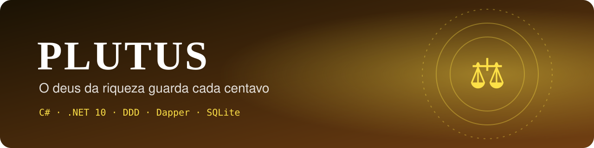
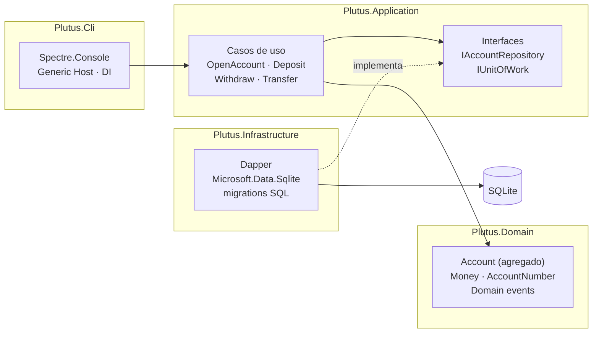
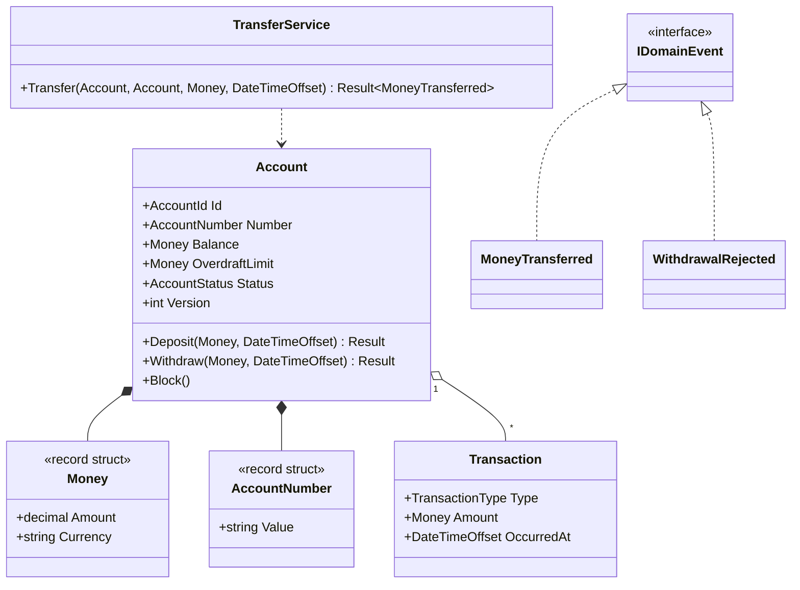
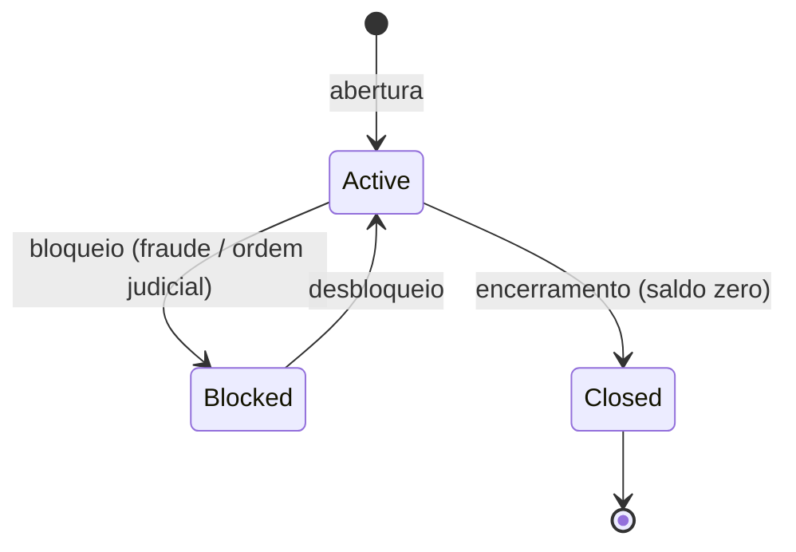
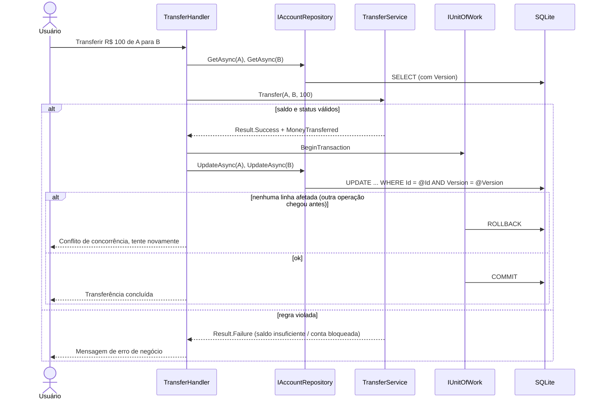

<div align="center">



# ⚖ Plutus
### O deus da riqueza guarda cada centavo

**Livro-razão bancário em C# / .NET 10, com foco em modelagem de domínio.**
Contas, depósitos, saques, transferências e extratos, com regras protegidas pelo próprio domínio,<br/>
transações explícitas com Dapper e concorrência otimista testada sob carga paralela.

[](https://github.com/GustavoThe01/plutus-ledger/actions/workflows/ci.yml)


</div>

---

## 👨‍💻 Autor

<table>
  <tr>
    <td width="62%">

Eu sou o **Gustavo Osterno Thé**, e o **Plutus** é um dos cinco projetos do meu portfólio público de Desenvolvedor Pleno. Idealizei, desenvolvo e mantenho este repositório.

Um sistema financeiro é o lugar onde **erros custam dinheiro de verdade**. Por isso pensei o Plutus para mostrar como um domínio bem modelado impede estados inválidos, como transações garantem consistência e como testar o que acontece quando duas operações tentam mexer no mesmo saldo ao mesmo tempo.

    </td>
    <td width="38%">

| | |
|---|---|
| 🌐 Site | [site-gustavothe-dev.web.app](https://site-gustavothe-dev.web.app/) |
| 💼 LinkedIn | [gustavoosterno](https://www.linkedin.com/in/gustavoosterno/) |
| 🐙 GitHub | [@GustavoThe01](https://github.com/GustavoThe01) |
| 📸 Instagram | [@gustavo.osterno](https://www.instagram.com/gustavo.osterno) |

    </td>
  </tr>
</table>

---

## 📑 Sumário

- [Em números](#-em-números)
- [A origem do nome](#-a-origem-do-nome)
- [O que o sistema faz](#-o-que-o-sistema-faz)
- [Arquitetura](#️-arquitetura)
- [Modelo de domínio](#-modelo-de-domínio)
- [Como uma transferência acontece](#-como-uma-transferência-acontece)
- [Competências demonstradas](#-competências-demonstradas)
- [Metodologias e decisões](#-metodologias-e-decisões)
- [Roadmap](#️-roadmap)
- [Como rodar](#-como-rodar)
- [Testes](#-testes)
- [Estrutura do projeto](#-estrutura-do-projeto)
- [O que ainda falta](#-o-que-ainda-falta)
- [Projetos relacionados](#-projetos-relacionados)

---

## 📊 Em números

<div align="center">

| 💎 Domínio | 🧱 Arquitetura | 🧪 Qualidade | 🗓️ Processo |
|:---:|:---:|:---:|:---:|
| **1** agregado (`Account`) | **4** projetos + testes | warnings tratados como **erro** | **10** dias de roadmap |
| value objects com `record struct` | regra de dependência **testada** | xUnit v3 · Microsoft.Testing.Platform | **1** ADR registrado |
| domain events + Result pattern | Central Package Management | NetArchTest (planejado) | Conventional Commits |

<sub>Metas para o fim do roadmap. O estado atual está nos badges, na seção <a href="#-testes">Testes</a> e em <a href="#-o-que-ainda-falta">O que ainda falta</a>.</sub>

</div>

---

## ⚖ A origem do nome

> *Plutus, filho de Deméter, era o deus grego da riqueza. Segundo o mito, Zeus o cegou para que ele não distinguisse justos de injustos ao distribuir a fortuna.*

Escolhi o nome porque um livro-razão precisa ter essa mesma cegueira: ser **imparcial e exato**. No Plutus, cada centavo que entra ou sai é registrado, nenhum saldo muda sem uma transação que o justifique, e as regras valem igualmente para todas as contas.

---

## ✨ O que o sistema faz

| Módulo | O que resolve |
|---|---|
| 🏦 **Contas** | Abertura, bloqueio e encerramento, com número de conta validado |
| ➕ **Depósitos** | Entrada de valores com registro no extrato |
| ➖ **Saques** | Respeitam saldo e limite; conta bloqueada não movimenta |
| 🔁 **Transferências** | Débito e crédito na **mesma transação**: ou acontecem os dois, ou nenhum |
| 📜 **Extrato** | Por período, paginado, com saldo acumulado e resumo mensal (LINQ) |
| 💸 **Tarifas e juros** | Regras diferentes por tipo de conta (Strategy) |
| 🖥️ **Console** | Interface rica com Spectre.Console: tabelas, cores e prompts |

---

## 🏛️ Arquitetura



| Projeto | Responsabilidade | Depende de |
|---|---|---|
| `Plutus.Domain` | Regras de negócio puras | — |
| `Plutus.Application` | Orquestra casos de uso | Domain |
| `Plutus.Infrastructure` | Banco, Dapper, migrations | Application |
| `Plutus.Cli` | Interface e composition root | Application, Infrastructure |

> ✅ A regra "**Domain não depende de ninguém**" já está protegida por um teste automatizado que escrevi no Dia 01 ([`LayerDependencyTests`](tests/Plutus.Domain.Tests/LayerDependencyTests.cs)).

---

## 🧬 Modelo de domínio



### Estados de uma conta



---

## 🔁 Como uma transferência acontece



---

## 🧠 Competências demonstradas

| Área | Conceitos |
|---|---|
| **DDD tático** | Agregados, entidades, value objects, domain services, domain events, linguagem ubíqua |
| **C# moderno** | `record`/`record struct`, nullable reference types, `required`, pattern matching |
| **Tratamento de erros** | **Result pattern** para regras de negócio, exceções só para o inesperado |
| **Dados** | Dapper, SQL escrito à mão, `IDbTransaction`, migrations SQL versionadas |
| **Concorrência** | Concorrência **otimista** com coluna `Version`, teste de transferências paralelas |
| **Assíncrono** | `async/await` com `CancellationToken` ponta a ponta |
| **LINQ** | Projeções, agrupamentos, execução adiada, `IEnumerable` vs `IQueryable` |
| **Infra .NET** | Generic Host, DI, Options pattern, `ILogger` |
| **Organização** | `.slnx`, `Directory.Build.props`, Central Package Management, `.editorconfig` |
| **Testes** | xUnit v3, NSubstitute, testes de integração e de arquitetura |

---

## 🧭 Metodologias e decisões

- **TDD** no domínio: primeiro escrevo o teste que descreve a regra, depois a implementação.
- **Roadmap diário público** — avanço um dia de cada vez e registro tudo no [ROADMAP.md](ROADMAP.md).
- **Conventional Commits**, versionamento semântico e **ADRs**.
- **Warnings são erros**: configurei o build para quebrar antes de um problema chegar ao `main`.

| ADR | Decisão | Status |
|---|---|---|
| [0001](docs/adr/0001-dapper-em-vez-de-ef-core.md) | Dapper em vez de EF Core (EF Core fica para o Bifrost, para comparação) | ✅ Aceita |

---

## 🗺️ Roadmap

| Semana | Dias | Tema | Progresso |
|---|---|---|---|
| 1 | 01–05 | Solution, value objects, agregado, domain events, casos de uso, Dapper | 🟨🟨🟨🟨🟨 |
| 2 | 06–10 | LINQ e extratos, console, concorrência, testes avançados, release | ⬜⬜⬜⬜⬜ |

Detalhes no [ROADMAP.md](ROADMAP.md) · Mudanças no [CHANGELOG.md](CHANGELOG.md).

---

## 🚀 Como rodar

**Pré-requisito:** [.NET 10 SDK](https://dotnet.microsoft.com/download).

```bash
git clone https://github.com/GustavoThe01/plutus-ledger.git
```

```bash
cd plutus-ledger
```

Compilar a solution:

```bash
dotnet build
```

Rodar os testes:

```bash
dotnet test
```

Executar o console:

```bash
dotnet run --project src/Plutus.Cli
```

> 📦 A partir do Dia 10 haverá um executável único (single-file) na aba *Releases*.

---

## 🧪 Testes

Os testes usam **xUnit v3** sobre o **Microsoft.Testing.Platform**, o novo executor de testes do .NET 10 (configurado em [`global.json`](global.json)).

| Projeto de teste | Tipo | Situação |
|---|---|---|
| `Plutus.Domain.Tests` | Unitários do domínio + regra de camadas | ✅ 58 testes (Account, TransferService, Money, AccountNumber, camadas) |
| `Plutus.Application.Tests` | Casos de uso com NSubstitute, DI e Options | ✅ 16 testes |
| `Plutus.IntegrationTests` | Dapper + SQLite em memória, com as migrations reais | ✅ 11 testes · ⏳ concorrência no Dia 08 |
| Testes de arquitetura | NetArchTest | ⏳ Dia 09 |

---

## 📁 Estrutura do projeto

```
plutus-ledger/
├── .github/workflows/ci.yml        # ✅ restore, build e testes a cada push
├── docs/
│   ├── adr/                        # ✅ decisões de arquitetura
│   └── assets/                     # ✅ banner e imagens
├── src/
│   ├── Plutus.Domain/              # ✅ Account, TransferService, Money, Result, eventos
│   ├── Plutus.Application/         # ✅ casos de uso, portas, DI e Options
│   ├── Plutus.Infrastructure/      # ✅ Dapper, migrations e transações
│   └── Plutus.Cli/                 # ✅ banner · ⏳ Dia 07 — Spectre.Console
├── tests/
│   ├── Plutus.Domain.Tests/        # ✅ testes do domínio e de arquitetura
│   ├── Plutus.Application.Tests/   # ✅ testes dos casos de uso
│   └── Plutus.IntegrationTests/    # ✅ testes com SQLite real
├── Plutus.slnx
├── Directory.Build.props           # ✅ Nullable, warnings como erro
├── Directory.Packages.props        # ✅ versões centralizadas
├── global.json                     # ✅ SDK + Microsoft.Testing.Platform
├── .editorconfig
├── CHANGELOG.md
└── ROADMAP.md
```

---

## 🧩 O que ainda falta

Mantenho aqui um checklist vivo do que ainda vou incrementar neste repositório.

**Projeto**
- [x] `Money`, `AccountNumber` e agregado `Account` com testes (Dia 02)
- [x] Depósito, saque, transferência, Result pattern e domain events (Dia 03)
- [x] Casos de uso, DI e Options pattern (Dia 04)
- [x] Persistência com Dapper + SQLite e migrations (Dia 05)
- [ ] Extratos com LINQ (Dia 06)
- [ ] Console com Spectre.Console e Generic Host (Dia 07)
- [ ] Concorrência otimista com teste paralelo (Dia 08)
- [ ] Testes de integração, mocks e NetArchTest (Dia 09)
- [ ] Tarifas com Strategy, publish single-file e release `v1.0.0` (Dia 10)

**README**
- [ ] GIF do console em funcionamento (extrato e transferência)
- [ ] Badge de cobertura de testes
- [ ] Resultado real do teste de concorrência (quantas transferências paralelas, saldo final)
- [ ] Atualizar "Em números" e a tabela de testes com valores reais
- [ ] Definir e adicionar uma licença (`LICENSE`)
- [ ] Versão em inglês do README

---

## 🔗 Projetos relacionados

| Projeto | Stack | Relação |
|---|---|---|
| ☿ [Mercurium](https://github.com/GustavoThe01/mercurium-sql) | SQLite | Fundamentos de modelagem e SQL |
| ⚒ [Nidavellir](https://github.com/GustavoThe01/nidavellir-inventory) | Java 21 | O mesmo nível de fundamento, em Java |
| ⚖ **Plutus** | C# + Dapper | *você está aqui* |
| ♾ [Moirai](https://github.com/GustavoThe01/moirai-taskflow) | Spring Boot | API completa em Java |
| ✦ [Bifrost](https://github.com/GustavoThe01/bifrost-orders) | ASP.NET Core | **O par deste projeto em .NET**: EF Core, CQRS e API completa |

<div align="center">

<sub>Contado por mim, centavo por centavo · <a href="https://github.com/GustavoThe01">Gustavo Osterno Thé</a></sub>

</div>
